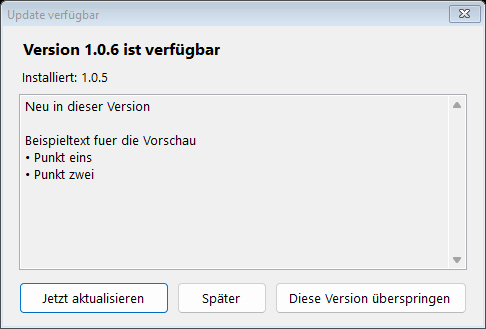
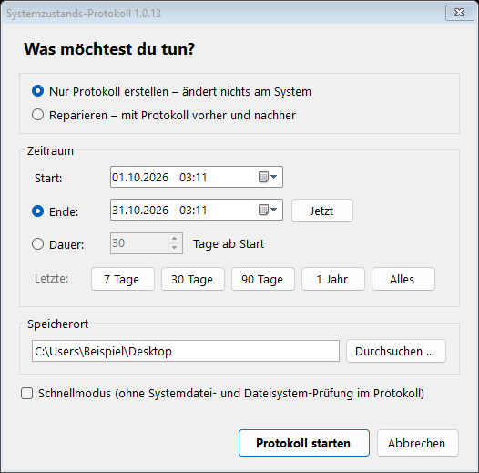
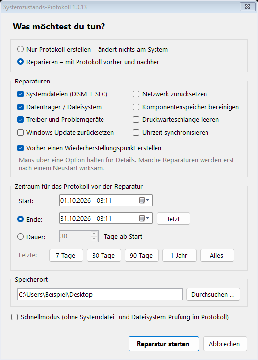
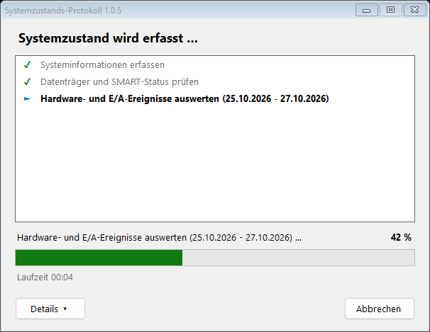
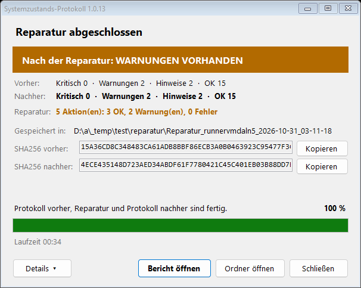

# Systemzustands-Protokoll für Windows

Ein Diagnosetool, das **Hardware-, E/A- und kritische Windows-Fehler** sammelt und daraus einen
Zustandsbericht mit Prüfsummen erstellt. Gedacht ist es für den Fall, dass du einen PC oder ein
Notebook **zur Reparatur gibst**: Du kannst damit belegen, in welchem Zustand das System vor der
Abgabe war.

Das Tool **liest nur** und ändert nichts am System.

## Was geprüft wird

| Bereich | Inhalt |
|---|---|
| Hardware-Daten | Hersteller, Modell, Seriennummern von Gerät, Mainboard, RAM-Modulen und Festplatten |
| Festplatten | Zustand, SMART-Ausfallvorhersage, nicht korrigierbare Lese-/Schreibfehler, Temperatur, Verschleiß, Betriebsstunden, Dateisystem-Scan (nur lesend) |
| Ereignisprotokolle | Datenträger-E/A, NTFS, SATA/NVMe-Controller, WHEA-Hardwarefehler, Bluescreens, unerwartete Neustarts, Grafiktreiber-Resets, thermische Drosselung, Speichertest |
| Weitere Prüfungen | Geräte-Manager-Fehlercodes, Absturzabbilder, Zuverlässigkeitsindex, Akkuzustand, DISM- und SFC-Prüfung |

## Ergebnis

Am gewählten Speicherort (Standard: Desktop) entsteht ein Ordner `Systemprotokoll_<PC-Name>_<Datum>` und eine ZIP-Datei
mit demselben Inhalt:

- `Zustandsbericht.pdf` / `.html`: Gesamtbewertung (grün, gelb oder rot), alle Befunde und Unterschriftsfelder
- `Fehler_System.csv`, `Fehler_Anwendungen.csv`, `Hardware_Ereignisse.csv`
- `Rohdaten/*.evtx`: unveränderte Original-Ereignisprotokolle
- `Pruefsummen_SHA256.txt`: Prüfsummen aller Dateien

## Download

**[Systemprotokoll.exe herunterladen](../../releases/latest/download/Systemprotokoll.exe)**: Doppelklick, Administratorrechte bestätigen, fertig.

Die EXE wird bei jeder Änderung automatisch von GitHub Actions gebaut (siehe *Releases*).

### Automatische Updates

Bei jedem Start prüft die EXE, ob es auf GitHub eine neuere Version gibt. Falls ja, erscheint ein
Fenster mit den Neuerungen und den Optionen **Jetzt aktualisieren**, **Später** und
**Diese Version überspringen**. Beim Aktualisieren wird die neue EXE heruntergeladen, per
SHA256 geprüft, an die Stelle der alten gelegt und sofort gestartet.



Ohne Internet oder mit `--kein-update` startet das Tool ohne Prüfung. Im stillen Modus (`-Still`)
wird nicht nach Updates gefragt. `Systemprotokoll.exe --version` zeigt die installierte Version.
Selbst gebaute EXEs (`EXE_erstellen.bat`) haben kein Auto-Update.

## So sieht es aus

Nach dem Start (und der Bestätigung der Administratorrechte) wählst du, ob nur ein Protokoll erstellt oder repariert werden soll, dazu Zeitraum und Speicherort:





Danach läuft die Prüfung im Hintergrund, ohne PowerShell-Fenster. Du siehst die einzelnen Schritte,
den Fortschritt in Prozent und die Laufzeit. Am Ende zeigt das Fenster die Gesamtbewertung, den
Speicherort und die SHA256-Prüfsumme des ZIP-Archivs. Über „Bericht öffnen“ und „Ordner öffnen“
kommst du direkt zum Ergebnis.



## Reparatur mit Vorher/Nachher-Protokoll

Im Startfenster kannst du statt „Nur Protokoll erstellen“ auch **„Reparieren“** wählen. Dann läuft
alles in drei Phasen automatisch ab:

1. **Protokoll vor der Reparatur** – dokumentiert den Ausgangszustand (Ordner `Vorher_…`).
2. **Reparatur** – nur mit Windows-Bordmitteln; jede Aktion wird mit Befehl, Zeit, Ergebnis und
   Ausgabe protokolliert (Ordner `Reparaturprotokoll_…`, HTML + JSON + Prüfsummen).
3. **Protokoll nach der Reparatur** – mit einer Vergleichstabelle vorher/nachher je Bereich und der
   Liste aller durchgeführten Reparaturen (Ordner `Nachher_…`).

Alles landet zusammen in einem Ordner `Reparatur_<PC-Name>_<Datum>` am gewählten Speicherort.

| Reparatur | Was passiert |
|---|---|
| Systemdateien (DISM + SFC) | `DISM /RestoreHealth` und `sfc /scannow` – repariert beschädigte Windows-Dateien (10–40 Min., braucht Internet) |
| Datenträger / Dateisystem | Prüft alle NTFS-Laufwerke; repariert nur bei gefundenen Fehlern. Systemlaufwerk: Reparatur beim nächsten Neustart |
| Treiber und Problemgeräte | Geräte mit Fehlercode im Geräte-Manager werden neu gestartet, bei Bedarf entfernt und neu erkannt (Treiber-Neuinstallation) |
| Windows Update zurücksetzen | Update-Dienste neu starten, `SoftwareDistribution` und `catroot2` zurücksetzen (alte Ordner werden als `.bak_…` gesichert) |
| Netzwerk zurücksetzen | Winsock, TCP/IP und DNS-Cache – wirksam nach Neustart |
| Komponentenspeicher bereinigen | `DISM /StartComponentCleanup` |
| Druckwarteschlange leeren | Druckdienst neu starten, hängende Aufträge entfernen |
| Uhrzeit synchronisieren | `w32tm /resync` |

Vorher wird auf Wunsch ein **Wiederherstellungspunkt** erstellt. Muss für eine Reparatur neu gestartet
werden, zeigt das Ergebnisfenster das deutlich an – nach dem Neustart am besten noch einmal ein
Protokoll erstellen.

Per Kommandozeile:

```bat
Systemprotokoll.exe -Reparatur "System,Datentraeger,Treiber" -Wiederherstellungspunkt -Tage 30
```



## Benutzung ohne EXE

1. Lade das Repository herunter: **Code → Download ZIP**. Danach Rechtsklick auf die ZIP-Datei und **„Alle extrahieren“**.
2. Doppelklicke auf **`Systemprotokoll_starten.bat`** und bestätige die Frage nach Administratorrechten.
3. Der Durchlauf dauert etwa 5–15 Minuten. Am Ende öffnet sich das PDF von selbst.

### Zeitraum festlegen

Beim Start öffnet sich ein Fenster, in dem du den **Start** (Datum und Uhrzeit) und entweder das
**Ende** oder eine **Dauer in Tagen** auswählst. Es gibt Schnellwahl-Knöpfe (7, 30, 90 Tage,
1 Jahr, Alles) und einen Schnellmodus ohne SFC und Dateisystem-Scan.

### Speicherort festlegen

Im Startfenster bestimmst du, wo das Protokoll gespeichert wird (Standard: Desktop). Über
„Durchsuchen …“ wählst du einen Ordner aus, z.B. einen USB-Stick oder ein Netzlaufwerk. Der zuletzt
gewählte Ordner wird beim nächsten Start vorgeschlagen. Existiert der Ordner noch nicht, wird er
angelegt. Per Parameter geht das mit `-Ziel "D:\Nachweise"`.

Alternativ per Parameter, dann erscheint kein Fenster (funktioniert mit `.bat` und `.exe`):

```bat
Systemprotokoll.exe -Von 01.09.2026 -Bis "15.10.2026 18:00"   :: fester Zeitraum
Systemprotokoll.exe -Von 01.09.2026 -Dauer 14                 :: 14 Tage ab Start
Systemprotokoll.exe -Tage 90                                  :: die letzten 90 Tage
Systemprotokoll.exe -Schnell                                  :: ohne SFC und Dateisystem-Scan
Systemprotokoll.exe -Tage 30 -Ziel "E:\Nachweise"            :: anderer Speicherort
Systemprotokoll.exe -Tage 7 -Still                            :: ganz ohne Fenster (z.B. geplante Aufgabe)
```

Gibst du bei `-Bis` nur ein Datum an, zählt der ganze Tag mit. Ein Ende in der Zukunft wird
auf „jetzt“ begrenzt. Reicht das Windows-Ereignisprotokoll nicht so weit zurück, steht das als
Hinweis im Bericht.

### Optional: als EXE

Doppelklicke auf **`EXE_erstellen.bat`**. Die Datei erzeugt mit dem in Windows eingebauten
C#-Compiler (.NET Framework 4) eine einzelne **`Systemprotokoll.exe`**, in der das Skript
eingebettet ist.

Falls Windows „Der Computer wurde durch Windows geschützt“ anzeigt, klicke auf
**„Weitere Informationen“** und dann auf **„Trotzdem ausführen“**.

## Tipps für einen belastbaren Nachweis

1. Schick dir die ZIP-Datei direkt nach der Erstellung per E-Mail oder lade sie in einen Cloud-Speicher hoch. Dann ist der Zeitpunkt unabhängig belegt.
2. Lass dir den ausgedruckten Bericht bei der Abgabe von der Werkstatt gegenzeichnen.
3. Fotografiere zusätzlich Gehäuse, Display und Anschlüsse. Optische Schäden erfasst kein Software-Tool.

> **Hinweis:** Der Bericht dokumentiert den technischen Zustand zum Zeitpunkt der Erstellung.
> Er ist ein starkes Indiz, aber keine Rechtsberatung und keine Garantie.

## Voraussetzungen

Windows 10 oder 11, Windows PowerShell 5.1 (vorinstalliert) und Administratorrechte.

## Lizenz

MIT, siehe [LICENSE](LICENSE).
